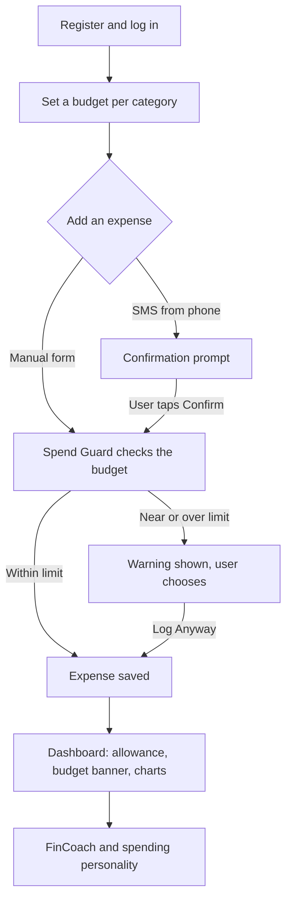
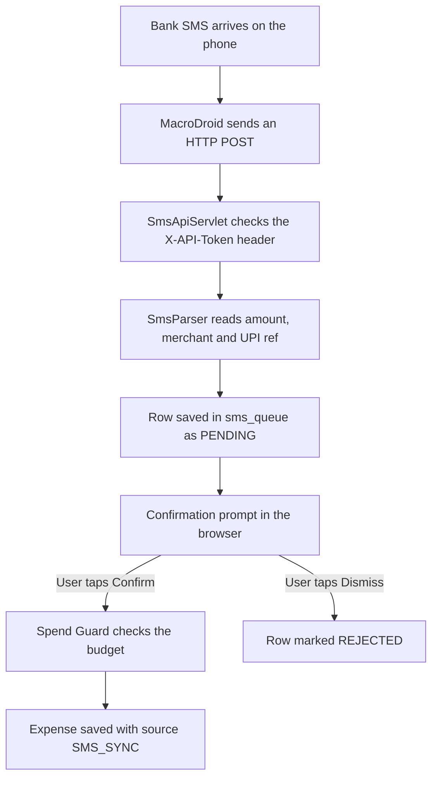
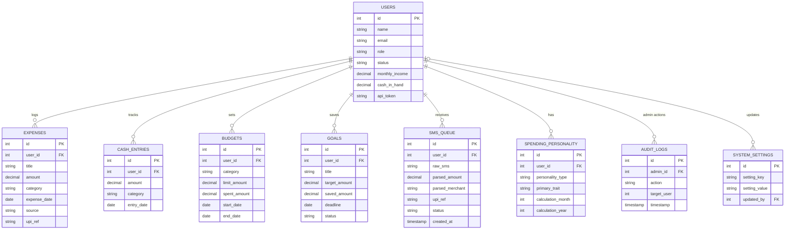

# MyFinance 2.0

MyFinance is a personal finance web application built with Java Servlets, JSP, JDBC and MySQL. Most expense trackers show what has already been spent. MyFinance warns the user before an expense is saved, so the budget check happens before the money is gone.

The target users are young working professionals who pay through UPI and cash and want a simple view of where their money goes.

MyFinance 2.0 is a team project developed by four members.

---

## Contents

1. [Features](#features)
2. [Problems addressed](#problems-addressed)
3. [Technology and requirements](#technology-and-requirements)
4. [Installation and running](#installation-and-running)
5. [Feature walkthrough](#feature-walkthrough)
6. [SMS sync with a phone](#sms-sync-with-a-phone)
7. [Project structure](#project-structure)
8. [Database design](#database-design)
9. [Java concepts used](#java-concepts-used)
10. [JDBC and data access](#jdbc-and-data-access)
11. [Servlets and web layer](#servlets-and-web-layer)
12. [Security and coding rules](#security-and-coding-rules)
13. [Testing](#testing)
14. [Known limitations](#known-limitations)
15. [Possible improvements](#possible-improvements)

---

## Features

**Expense tracking.** Users log digital expenses with a title, amount, category and date, and can filter them by category, month and year. When a title such as "Swiggy" or "Uber" is typed, the category is suggested automatically from a keyword list.

**Spend Guard.** Before an expense is saved, the server checks the budget for its category. At 80% of the limit or more, a warning is shown. Above 100%, the warning turns red. The message includes the calculation, for example `250 spent + 250 new = 500 of 200 limit`, and the user chooses Cancel or Log Anyway. This applies to manual expenses and to expenses confirmed from SMS.

**Budgets.** Each budget has a category, a limit and a date range. Cards show progress bars, the remaining amount (negative when overspent) and an alert banner while a budget is near or over its limit.

**Savings goals.** Goals have a target amount, a deadline, a progress bar and milestone badges. Adding savings updates the progress, and a goal becomes Achieved automatically when the saved amount reaches the target.

**Cash tracker.** Cash spending is stored separately from digital spending. The user sets cash in hand, each cash expense reduces it automatically, and a month-end reconciliation compares the expected balance with the actual one.

**Daily allowance.** The dashboard shows how much can still be spent per day:

```
(total budget limits − spending in budgeted categories) ÷ days left in the month
```

When the user is over budget, the value is negative and shown in red instead of being hidden as zero. The formula is shown with real numbers on the card.

**Weekly insight.** A short plain-English tip on the dashboard, based on recent spending trends.

**Spending personality.** The application scores seven spending personalities (Planner, Foodie, Impulsive Shopper, Commuter, Explorer, Experience Seeker and Wellness Warrior) from the last 30 days of expenses, using category shares and weekend spending. The result is shown with a transparent score breakdown. It needs expense data on at least 7 different days (the `personality_min_days` admin setting).

**FinCoach.** A chat page with two modes. Questions about the user's own money are answered from the database and labelled "Your data". General finance questions are sent to the Gemini API with a SEBI disclaimer and labelled "AI". Personal numbers are never sent to Gemini.

**SMS sync.** Bank debit messages are forwarded from an Android phone to the server. The server reads the amount, merchant and UPI reference and asks the user to confirm. An expense is created only after the user confirms.

**Offline queue.** If the connection is lost, expenses entered in the browser are kept in local storage and sent later.

**Profile.** Users can update their monthly income and cash baseline and regenerate their personal API token (used by SMS sync).

**Administration.** An admin console offers an overview with counters and recent audit logs, user management (search, role change, status change, delete), a security page with an audit history, and system settings (platform name, currency, feature switches). Every admin change is written to the audit log.

---

## Problems addressed

| Problem | How the application handles it |
|---|---|
| Spending is visible only after it happened | Spend Guard warns before the expense is saved |
| Entering every expense by hand is tedious | Category suggestions and SMS sync with one-tap confirmation |
| Cash spending is missing from bank-based apps | Separate cash tracker with a month-end reconciliation |
| Users do not know what they can spend today | Daily allowance with the formula shown |
| AI money advice can be wrong or unsafe | FinCoach keeps personal numbers out of the AI and adds a disclaimer |
| Users do not understand their habits | Spending personality built from real data |

### User flow



---

## Technology and requirements

| Part | Technology |
|---|---|
| Language | Java 17 |
| Web layer | Jakarta Servlet 6.0 and JSP with JSTL |
| Data access | Plain JDBC with the DAO pattern (MySQL Connector/J 8.0.33) |
| Database | MySQL 8.0 |
| Passwords and sessions | BCrypt (jBCrypt 0.4) and HttpSession |
| JSON | org.json |
| Background work | Java threads (`Runnable`) |
| Frontend | HTML, CSS, vanilla JavaScript, Canvas API for charts |
| AI (optional) | Google Gemini API |
| Build | Maven (WAR packaging) |
| Server | Embedded Apache Tomcat 10.1, started from `AppServer.java` |
| Tests | JUnit 5 |

Required software:

- JDK 17
- Maven 3.x
- MySQL 8.0 and MySQL Workbench (or the `mysql` command line)

Optional:

- A Gemini API key, for the AI mode of FinCoach
- An Android phone with the MacroDroid app, for live SMS sync

A separate Tomcat installation is not needed.

---

## Installation and running

**Step 1. Get the code**

```
git clone https://github.com/DeepLearningBackend/MyFinance.git
cd MyFinance
```

**Step 2. Create the database**

Start MySQL and run the schema file. It creates the `myfinancedb` database and its 9 tables.

```
mysql -u root -p < database/schema.sql
```

The file can also be opened and run in MySQL Workbench. Afterwards `myfinancedb` contains 9 tables.

Note: the script drops and recreates all 9 tables (`DROP TABLE IF EXISTS`), so any existing data in them is deleted. It also inserts the default system settings and one admin account (see Step 5).

**Step 3. Set the environment variables**

Database settings and the Gemini key are read from environment variables, so no secrets are stored in the code. Set them in the same terminal that will start the server.

Windows (PowerShell):

```
$env:DB_PASS="your-mysql-password"
$env:GEMINI_API_KEY="your-gemini-key"
```

Linux or macOS:

```
export DB_PASS="your-mysql-password"
export GEMINI_API_KEY="your-gemini-key"
```

| Variable | Meaning | Default |
|---|---|---|
| `DB_URL` | JDBC URL of the MySQL database | `jdbc:mysql://localhost:3306/myfinancedb` with `useSSL=false`, `allowPublicKeyRetrieval=true`, `serverTimezone=Asia/Kolkata` and UTF-8 |
| `DB_USER` | MySQL user | `root` |
| `DB_PASS` | MySQL password | empty, so set it if the MySQL user has a password |
| `GEMINI_API_KEY` | Key for the AI mode of FinCoach | none, FinCoach then answers general questions with a built-in educational text |

The application connects to MySQL only. If MySQL is not running or the password is wrong, it stops with an error message that says what to check.

**Step 4. Start the application**

```
mvn exec:java
```

This starts the embedded Tomcat from `com.myfinance.AppServer` on port 8080 with the context path `/myfinance`. The `main` method of `AppServer.java` can also be run directly from an IDE. The console prints the local address and the Wi-Fi address of the machine.

Open:

```
http://localhost:8080/myfinance/auth
```

**Step 5. Log in**

- To use the application as a normal user, register a new account on the login page.
- To open the admin console, log in with the account created by `schema.sql`: `admin@myfinance.com` with password `admin123`. These credentials are for local demonstration only.

**Step 6. Run the tests**

```
mvn clean test
```

The tests run on a temporary embedded H2 database that Maven enables automatically (`DB_FALLBACK=true`), so they never touch the data in MySQL. The running application itself never uses H2.

**Optional: build a WAR file**

```
mvn clean package
```

This creates `target/myfinance.war`, which can be deployed to a Tomcat 10.1 server.

---

## Feature walkthrough

These steps show each feature on the running website. The menu names match the application sidebar.

**1. Register and log in**
1. Open `http://localhost:8080/myfinance/auth` and register a new account.
2. Log in. The dashboard opens.

**2. Budgets**
1. Open **Budgets** and create a budget for Food & Dining with a limit of 200 and a date range that includes today.
2. The budget appears as a card with a progress bar.

**3. Expenses, category suggestion and Spend Guard**
1. Open **Expenses**. Type a title such as "Swiggy". The category Food & Dining is suggested.
2. Add the expense with an amount of 250.
3. A red warning appears with the calculation `0 spent + 250 new = 250 of 200 limit`.
4. Choose **Cancel** to stop, or **Log Anyway** to save it.
5. After saving, the dashboard and the Budgets page show a banner such as `200 budget − 250 spent = −50 (over limit)`. It stays visible on every page load until the budget is back under its limit.

**4. Daily allowance**
1. Open the **Dashboard**.
2. The "Left to spend today" card shows the daily amount with its formula. A negative value means the budgets are exceeded. Spending in categories without a budget is shown on a separate line.

**5. SMS sync**
1. Open **Expenses** and find the SMS paste box.
2. Paste this message and submit:
   ```
   Rs 250.00 debited from A/c XX1234 via UPI to Zomato. Ref 412398765432
   ```
3. Within a few seconds a confirmation prompt appears (and the Expenses page lists it under "Mobile SMS Live Sync") with the amount, merchant and UPI reference.
4. Click **Confirm**. Spend Guard runs first if the category has a budget, and the expense then appears in the expense list. **Dismiss** rejects the message instead.
5. For live sync from a phone, see [SMS sync with a phone](#sms-sync-with-a-phone).

**6. Cash tracker**
1. Open **Cash Tracker** and set the cash in hand.
2. Add a cash expense. The cash in hand decreases automatically.
3. Use the reconciliation tool at the end of the month to compare the expected and actual balance.

**7. Goals**
1. Open **Goals** and create a goal with a target amount and a deadline.
2. Add savings. The progress bar moves, and the goal becomes Achieved when the saved amount reaches the target.

**8. Spending personality**
1. Open **My Personality**.
2. With expenses on at least 7 different days in the last 30 days, the page reveals the personality with its score breakdown. With less data, it asks for more.

**9. FinCoach**
1. Open **FinCoach AI**. Suggestion chips offer example questions.
2. Ask a personal question, such as "How much have I spent on food?". The answer comes from the database and is labelled "Your data".
3. Ask a general question, such as "What is a SIP?". With a Gemini key, the answer is labelled "AI" and includes the SEBI disclaimer.

**10. Profile**
1. Open **Profile & Sync** to change the monthly income and cash baseline.
2. The page shows the API token used for SMS sync (with Copy and Regenerate buttons), the webhook address and an example `curl` command.

**11. Admin console**
1. Log in as `admin@myfinance.com` (see Installation, Step 5).
2. **Overview** shows counters and recent logs. **User Accounts** supports search, role change, status change and delete. **Security & Audit** and **System Settings** show and store the platform settings (some security switches are stored settings only, see Known limitations). Each change appears in the audit log.

---

## SMS sync with a phone

A Java web application cannot read SMS messages from a phone. The phone has to send the message text to the server. This project uses MacroDroid, a free Android automation app, for that step. Everything after the HTTP request is handled by the Java code.



**Setup**

1. Connect the phone and the computer to the same Wi-Fi. If the network blocks device-to-device traffic, use the phone's hotspot and connect the computer to it.
2. Start the server and note the Wi-Fi address printed in the console, for example `http://192.168.1.5:8080/myfinance`. The address can change when the network changes.
3. Allow port 8080 through the computer's firewall.
4. Log in, open **Profile & Sync**, and copy the API token. Keep it private.
5. In MacroDroid, create a macro:
   - Trigger: SMS received, message contains `debited`.
   - Action: HTTP request, method POST.
   - URL: `http://<computer-address>:8080/myfinance/api/sms-sync`
   - Header: `X-API-Token` with the copied token.
   - Content type: `text/plain`.
   - Body: insert the **SMS message** variable with the magic-text button.
6. In the phone's battery settings, set MacroDroid to unrestricted so Android does not stop it.

**Testing without a phone**

```
curl -X POST http://localhost:8080/myfinance/api/sms-sync \
  -H "Content-Type: text/plain" \
  -H "X-API-Token: <your token>" \
  -d "Rs 250.00 debited from A/c XX1234 via UPI to Zomato. Ref 412398765432"
```

Further sample messages are in `sample-sms.txt`. The Expenses page also has a paste box that sends text to the same endpoint, which is convenient for testing.

**How the endpoint behaves**

- Accepted bodies: plain text, a JSON object with an `sms`, `message` or `text` field, or a form field named `sms`.
- An empty, blank or placeholder message (for example `{sms_message}`) returns HTTP 400. So does a message with no amount or a zero amount. A missing or invalid token returns HTTP 401.
- A credit message (money received) is not queued. The endpoint answers HTTP 200 with `"saved":false` and the reason `credit ignored`.
- A message that is saved returns HTTP 200 with `"saved":true`.
- `GET` returns the pending messages and the live-sync status. `POST` with `action=confirm` turns a pending message into an expense, and `action=reject` dismisses it.
- The parser recognises amounts written as Rs, Rs., INR or the rupee sign, UPI reference numbers, and merchant names (from the text after "to", "at" or "for", from the ICICI "Info:" format, or from a list of well-known merchants). It handles message styles from SBI, HDFC, ICICI and Axis.
- The browser checks for new pending messages every 5 seconds. A background thread, `SmsProcessorThread`, checks the queue every 30 seconds and parses again any message that has no valid amount or merchant.
- Times are handled in the Asia/Kolkata timezone.

---

## Project structure

```
src/main/java/com/myfinance/
├── AppServer.java            starts the embedded Tomcat (port 8080, context /myfinance)
├── model/                    entities and data classes
│   ├── BaseEntity.java       abstract parent of User, Expense, Budget, Goal, CashEntry, SmsQueueItem, SpendingPersonality
│   ├── FinanceOperation.java generic interface implemented by four services
│   └── ...                   Category, SpendGuardAlert, PersonalityReport
├── dao/
│   ├── interfaces/           8 DAO interfaces
│   └── impl/                 8 JDBC implementations
├── service/                  business logic (11 classes)
├── servlet/                  10 servlets, plus 4 admin servlets in servlet/admin
├── thread/                   BudgetAlertThread, SmsProcessorThread
├── listener/                 AppStartupListener starts and stops the threads
├── exception/                DatabaseException, ValidationException
└── util/                     DBConnection, PasswordUtil, SessionUtil, SmsParser, CategoryMapper, ApiResponse

src/main/webapp/
├── WEB-INF/web.xml           servlet mappings, session timeout, error pages
├── css/                      global, layout, dashboard, auth, responsive
├── js/                       main, charts, sms-sync, fincoach, validation, offline
└── jsp/
    ├── auth/                 login, register
    ├── user/                 dashboard, expenses, budgets, goals, cash, personality, fincoach, profile
    ├── admin/                admin-dashboard, user-management, security, settings
    ├── common/               sidebars, topbar, navbar, flash message
    └── error/                403, 404, 500

src/test/java/com/myfinance/  JUnit tests
database/schema.sql           creates the 9 tables and the default data
sample-sms.txt                example bank messages for testing
pom.xml                       Maven build file
```

The layers are kept separate: servlets handle requests and responses, services hold the logic, DAOs hold the SQL, and models hold the data.

Services: `AuthService`, `ExpenseService`, `BudgetService`, `GoalService`, `CashService`, `AllowanceService`, `AllowanceCalculator`, `PersonalityService`, `PersonalityDetector`, `InsightService`, `FinCoachService`.

---

## Database design

The database has 9 tables. `database/schema.sql` contains the full definitions and the default data.



Key points:

- In `expenses`, `source` is `MANUAL` or `SMS_SYNC`. In `sms_queue`, `status` is `PENDING`, `CONFIRMED` or `REJECTED`. In `goals`, `status` is `IN_PROGRESS`, `ACHIEVED` or `FAILED`.
- Deleting a user also deletes that user's rows in the linked tables (`ON DELETE CASCADE`). For `system_settings`, `updated_by` is set to NULL instead.
- `schema.sql` seeds the default system settings (`platform_name`, `default_currency`, `session_timeout`, `max_login_attempts`, `budget_alerts_enabled`, `email_reports_enabled`, `personality_min_days`) and one admin account.

---

## Java concepts used

| Concept | Where it is used |
|---|---|
| Inheritance | `BaseEntity` is an abstract class (with an abstract `validate()`). `User`, `Expense`, `Budget`, `Goal`, `CashEntry`, `SmsQueueItem` and `SpendingPersonality` extend it. All 14 servlets extend `HttpServlet`, and the custom exceptions extend `RuntimeException` |
| Polymorphism | `FinanceOperation<T, R>` is a generic interface with `execute` and `summarize`. `ExpenseService`, `BudgetService`, `GoalService` and `CashService` implement it, each in its own way |
| Interfaces | Eight DAO interfaces (`UserDAO`, `ExpenseDAO`, `BudgetDAO`, `GoalDAO`, `CashDAO`, `SmsDAO`, `AuditLogDAO`, `SystemSettingsDAO`), each with a separate JDBC implementation. `Runnable` and `ServletContextListener` are also implemented |
| Exception handling | `DatabaseException` wraps JDBC and connection errors. `ValidationException` is thrown when an entity fails `validate()`. Servlets catch exceptions and show a friendly message |
| Collections | `List<Expense>`, `List<Budget>`, `List<Goal>`, `List<SmsQueueItem>`, and `Map`, `HashMap`, `LinkedHashMap`, `Set` and `HashSet` in the services, for example expenses grouped by category and the personality score map |
| Generics | `ApiResponse<T>` is a generic response wrapper, and `FinanceOperation<T, R>` is a generic interface |
| Multithreading | `BudgetAlertThread` (checks budgets every hour) and `SmsProcessorThread` (checks the SMS queue every 30 seconds) implement `Runnable` and run as daemon threads. `AppStartupListener` starts and stops them with the server |
| Synchronization | `checkAllUserBudgets()` in `BudgetAlertThread` and `processSmsQueue()` in `SmsProcessorThread` are `synchronized`. The stop flag in `BudgetAlertThread` is `volatile` |
| Regular expressions | `SmsParser` extracts amounts, UPI references and merchants. `CategoryMapper` matches keywords at word boundaries. `User` validates email addresses, and `FinCoachService` detects personal questions and strips amounts before a general question is sent to the AI |

---

## JDBC and data access

- `DBConnection` opens connections with `DriverManager.getConnection()`. The URL, user and password come from environment variables, and the timezone is set to Asia/Kolkata.
- Every table has a DAO interface and a JDBC implementation: `UserDAOImpl`, `ExpenseDAOImpl`, `BudgetDAOImpl`, `GoalDAOImpl`, `CashDAOImpl`, `SmsDAOImpl`, `AuditLogDAOImpl` and `SystemSettingsDAOImpl`.
- All queries use `PreparedStatement` with `?` placeholders. No SQL is built by joining strings.
- Connections and statements are opened with try-with-resources, so they close even when an error occurs.
- Each DAO converts a `ResultSet` row into a model object in a private mapping method.
- `ExpenseDAOImpl` also runs aggregate queries with `GROUP BY`, `SUM()`, `DAYOFWEEK()` and `DATE_FORMAT()` for the charts and the personality scores.
- Edit and delete queries include `AND user_id = ?`, so one user cannot change another user's data. `CashDAOImpl` adjusts `users.cash_in_hand` together with the cash entry.

---

## Servlets and web layer

The application has 14 servlets, mapped in `web.xml`. Every servlet except `SmsApiServlet` checks the HttpSession first (the admin servlets also check the ADMIN role). `SmsApiServlet` is called by the phone, which has no browser session, so it identifies the user by the API token.

| Servlet | URL | Methods | Purpose |
|---|---|---|---|
| `AuthServlet` | `/auth`, `/login`, `/register`, `/logout` | GET, POST | Login, register and logout |
| `DashboardServlet` | `/dashboard` | GET | Allowance, category totals, budgets, goals and the weekly insight |
| `ExpenseServlet` | `/expenses` | GET, POST | List and filter, add (with Spend Guard), edit, delete, category suggestion |
| `BudgetServlet` | `/budgets` | GET, POST | Create, edit and delete budgets, usage and alert banners |
| `GoalServlet` | `/goals` | GET, POST | Create, edit and delete goals, add savings |
| `CashServlet` | `/cash` | GET, POST | Set balance, add and delete cash entries, reconcile |
| `PersonalityServlet` | `/personality` | GET, POST | Calculate and show the spending personality, refresh |
| `FinCoachServlet` | `/fincoach` | GET, POST | Accepts questions and returns answers from the database or from Gemini |
| `ProfileServlet` | `/profile` | GET, POST | Update profile, regenerate the API token |
| `SmsApiServlet` | `/api/sms-sync` | GET, POST | Receive SMS text, list pending items, confirm or reject them |
| `AdminDashServlet` | `/admin/dashboard`, `/admin` | GET | Platform counters and recent audit logs |
| `UserMgmtServlet` | `/admin/users` | GET, POST | Search, change status or role, create and delete users |
| `SecurityServlet` | `/admin/security` | GET, POST | Session timeout, login attempts and audit history |
| `SettingsServlet` | `/admin/settings` | GET, POST | Currency, platform name and feature switches |

Pages are JSPs that receive their data from the servlets as request attributes. `web.xml` also sets the session timeout (30 minutes, HTTP-only cookie) and the 403, 404 and 500 error pages. The stylesheets have breakpoints at 1024px, 768px, 480px and 390px. On small screens the sidebar is replaced by a bottom navigation bar.

---

## Security and coding rules

1. Every servlet checks the session first. The only exception is `SmsApiServlet`, which uses the API token.
2. SQL always uses `PreparedStatement`, never string concatenation.
3. JDBC resources always use try-with-resources.
4. Passwords are hashed with BCrypt (cost factor 12) and never stored as plain text.
5. `validate()` runs before an entity is saved.
6. Spend Guard checks the budget before the INSERT.
7. AI is never used for the user's personal numbers. Personal questions are answered from the database only.
8. Every automated result shows how it was calculated.
9. An SMS becomes an expense only after the user confirms it.
10. Pages are designed for phone, tablet and desktop widths.
11. Edit and delete actions check that the record belongs to the logged-in user.
12. Servlets catch errors and show a friendly message instead of a stack trace.
13. Errors use the custom exceptions `DatabaseException` and `ValidationException`.
14. Collections and generics are used with proper types instead of raw types.

What this means for users:

- **Passwords.** Passwords are stored only as BCrypt hashes, so they cannot be read back, not even by an admin.
- **Your data stays yours.** Every read, edit and delete is tied to the logged-in account, so one user cannot see or change another user's expenses, budgets, goals or cash entries.
- **Sessions.** Sessions expire after 30 minutes of inactivity, and the session cookie is HTTP-only.
- **SMS.** The application never reads a phone. It only receives the messages that the user's own phone app forwards, and nothing becomes an expense until the user confirms it. The full text of a forwarded message is stored in the database so that it can be parsed.
- **SMS token.** The API token works only for its own account and can be regenerated at any time. The old token stops working.
- **AI.** FinCoach never sends amounts, balances, budgets or goals to the AI. Personal questions are answered from the database, and only general questions go to Gemini, with any numbers removed.
- **Admin actions.** Changes made in the admin console are recorded in the audit log.
- **Not covered yet.** The application runs over plain HTTP on a local machine, so HTTPS should be used if it is ever deployed. Two-factor login, encryption of stored data, IP whitelisting and a login-attempt lockout are not implemented, even though the admin security page has switches for some of them.

Other details:

- API tokens look like `myf_` followed by a random UUID without dashes.
- The database password and the Gemini key are read from environment variables. No secrets are stored in the repository.
- `schema.sql` creates a default admin account for local demonstration. Change its password before any real use.

---

## Testing

There are 41 JUnit tests in 11 test classes in `src/test/java/com/myfinance/`, run with `mvn clean test`. They cover:

| Test class | Covers |
|---|---|
| `DBConnectionTest` | Database connection |
| `UserDAOImplTest` | Creating, finding and deleting a user |
| `ModelEntityTest` | Validation rules of the entities |
| `AllowanceServiceTest` | Allowance pool, budgeted spending, days left, negative allowance |
| `BudgetServiceAlertTest` | Spend Guard at 80% and above 100% |
| `ExpenseServiceTest` | Expense validation, creation and category totals |
| `FinCoachServiceTest` | Routing of personal and general questions, disclaimer, fallback |
| `GoalServiceTest` | Goal progress and deadline |
| `CategoryMapperTest` | Keyword suggestions and word boundaries |
| `PasswordUtilTest` | BCrypt hashing and verification |
| `SmsParserTest` | SBI, HDFC, ICICI and Axis message formats, debit detection |

The tests run on a temporary embedded H2 database, so they do not use the MySQL data.

Manual testing covered logging in, adding and filtering expenses, exceeding a budget to trigger Spend Guard, and sending SMS from a phone through MacroDroid and confirming them on the website.

---

## Known limitations

- **SMS sync needs a helper app.** It works on Android with MacroDroid. There is no native mobile app, and iPhones do not allow the same kind of forwarding.
- **Same network only.** The phone sends messages to the computer's local address, so both must be on the same network and the address has to be updated when it changes. A deployed server with HTTPS would remove this limit. The endpoint also accepts the token as a query parameter, which is less safe than the header because URLs can end up in logs.
- **The SMS parser covers common formats.** Banks word their messages differently, so some messages may show "Unknown Merchant" or miss the UPI reference.
- **Spending personality needs data.** It needs expenses on at least 7 different days in the last 30 days.
- **FinCoach AI mode needs a key, internet access and a Gemini model that is still available.** Without them, general questions are answered with a built-in educational text.
- **Night-time spending is not analysed.** Expenses store only a date, not a time.
- **Local use only.** The application has been run on a local machine with an embedded Tomcat and has not been deployed to a public server.
- **Some admin security switches are settings only.** The switches for 2FA, AES encryption, IP whitelist and the login-attempt limit are stored in `system_settings` but are not enforced by the code.
- **Default admin account.** The seeded admin credentials are public in this repository and are meant for local demonstration only.
- **Categories are guessed from keywords.** Some expenses may need their category changed by hand.

## Possible improvements

- CSV export of expenses
- Recurring expenses
- A monthly summary email
- A native Android app for SMS sync
- Moving the SMS parser patterns into a configuration file
- Deploying with HTTPS so phone sync works from any network

